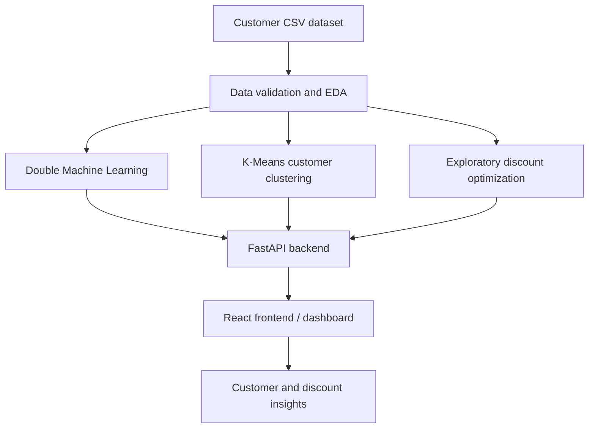

# EconoCausal

### Causal Machine Learning for Customer Discount Analysis

**Discover customer segments. Estimate discount impact. Support smarter
pricing decisions.**


------------------------------------------------------------------------

## Overview

**EconoCausal** is a customer analytics project exploring how discounts
relate to purchase behavior and how customers can be grouped by their
characteristics. It combines **Double Machine Learning (DML)** for
estimating discount effects with **K-Means clustering** for exploratory
customer segmentation.

The project uses a synthetic dataset of 5,000 customers. The current
work includes data exploration, validation, causal-effect estimation,
exploratory discount optimization, a FastAPI backend, and
customer-clustering experiments.

> **Important:** Results are based on synthetic data. A causal estimate
> is not automatically proof of causality; interpretation depends on the
> data-generating process and assumptions such as adequate confounding
> adjustment, overlap, and correct treatment/outcome definitions.

## Project highlights

-   **Causal effect estimation:** Uses Double Machine Learning to
    estimate the average effect of receiving a discount on purchase
    probability.
-   **Customer segmentation:** Uses K-Means to discover groups from
    demographic and behavioral features.
-   **Income and spending experiment:** A separate clustering script is
    being developed to profile purchasing customers using income, basket
    value, and purchase frequency. Validate its output before treating
    it as a finished result.
-   **Exploratory optimization:** Compares observed discount and revenue
    metrics; this is exploratory and should not be interpreted as a
    validated causal profit optimizer.
-   **API layer:** FastAPI endpoints expose project data and analysis to
    a frontend.
-   **Frontend integration:** A React frontend is used to consume
    backend API results.

## How the system fits together




## Dataset

The current synthetic dataset is:

`data/econocausal_synthetic_customers.csv`

It contains 5,000 customer records and 16 columns:

  Field                        Meaning
  ---------------------------- ----------------------------------------
  `customer_id`                Customer identifier
  `age`                        Customer age
  `annual_income_inr`          Annual income in INR
  `past_purchases_12m`         Purchases over the previous 12 months
  `days_since_last_purchase`   Recency of the last purchase
  `website_visits_30d`         Website visits in the previous 30 days
  `email_engagement_score`     Email engagement measure
  `customer_segment`           Existing segment label in the dataset
  `region`                     Customer region
  `season`                     Season associated with the record
  `discount_received`          Discount-treatment indicator
  `discount_percent`           Discount percentage
  `purchased`                  Purchase outcome
  `basket_value_inr`           Basket value in INR
  `discount_cost_inr`          Discount cost in INR
  `net_revenue_inr`            Net revenue in INR

## Methods

### 1. Double Machine Learning (DML)

The causal analysis treats `discount_received` as the treatment and
`purchased` as the outcome. Random-forest nuisance models and
cross-fitting are used in the existing implementation to adjust for
observed customer characteristics.

A previously recorded run estimated an average purchase-probability
effect of approximately **+5.39 percentage points**, with a 95%
confidence interval of **+2.63 to +8.16 percentage points**. This is an
estimate from the synthetic dataset, not a guaranteed real-world effect.

### 2. K-Means clustering

Two clustering experiments are being used/planned:

-   `backend/clustering.py` --- behavioral clustering using age, income,
    purchase history, purchase recency, website visits, and email
    engagement.
-   `backend/spending_clustering.py` --- separate income-and-spending
    experiment using income, basket value, and purchase frequency for
    purchasers. Run and validate this experiment before reporting its
    selected cluster count or profile results.

The behavioral clustering script compares candidate cluster counts from
2 to 6 using the silhouette score. In the recorded run, **4 clusters**
had the highest tested silhouette score (**0.1381**). This is a
relatively low score and suggests substantial overlap; the result should
be treated as exploratory, not as proof that the clusters are strongly
separated.

Cluster IDs such as `0`, `1`, and `2` are arbitrary labels.
Business-friendly names should only be assigned after inspecting cluster
profiles.


### 3. Exploratory discount optimization

The optimization module compares observed metrics across discount
levels. Observational differences alone do not prove that a discount
caused higher purchases or profit. A future validated optimizer should
incorporate causal estimates, uncertainty, constraints, and
profit-oriented evaluation.

## Repository structure

``` text
EconoCausal/
├── backend/
│   ├── main.py
│   ├── eda.py
│   ├── data_service.py
│   ├── causal_model.py
│   ├── customer_effects.py
│   ├── clustering.py
│   ├── spending_clustering.py
│   └── optimization.py
├── data/
│   ├── econocausal_data_dictionary.csv
│   └── econocausal_synthetic_customers.csv
├── frontend/
│   └── src/
│       └── api.js
├── docs/
│   └── images/
└── README.md
```

*The tree reflects the project files discussed during development;
adjust it if your actual repository differs.*

## Getting started

### Prerequisites

-   Python 3.10 or later recommended
-   Node.js and npm for the frontend
-   Git

### 1. Clone the repository

``` bash
git clone <YOUR_GITHUB_REPOSITORY_URL>
cd <YOUR_REPOSITORY_FOLDER>
```

Replace the placeholders with your actual repository URL and folder
name.

### 2. Create and activate a Python virtual environment

**Windows PowerShell:**

``` powershell
python -m venv .venv
.\.venv\Scripts\Activate.ps1
```

If PowerShell blocks activation, use your environment's approved
activation method or run the virtual environment's Python executable
directly.

### 3. Install backend dependencies

``` bash
python -m pip install fastapi "uvicorn[standard]" pandas numpy scipy scikit-learn doubleml
```

### 4. Run the analysis scripts

Run commands from the repository root:

``` bash
python -m backend.eda
python -m backend.data_service
python -m backend.causal_model
python -m backend.clustering
python -m backend.spending_clustering
```

Only run modules that exist in your current checkout. The
spending-clustering experiment should be validated before using its
output in a presentation or API.

### 5. Start the FastAPI backend

From the repository root:

``` bash
python -m uvicorn backend.main:app --reload
```

Alternatively, if you are inside the `backend` directory:

``` bash
python -m uvicorn main:app --reload
```

Open `http://127.0.0.1:8000/` to check the root endpoint and
`http://127.0.0.1:8000/docs` for interactive API documentation, if the
app is running.

### 6. Run the frontend

``` bash
cd frontend
npm install
npm run dev
```

Use the local URL printed by Vite. Ensure the frontend API base URL
matches the backend and the backend CORS configuration allows the
frontend origin.

## Current status

-   [x] Synthetic customer dataset and data dictionary
-   [x] Exploratory data analysis module
-   [x] Data validation/service module
-   [x] Double Machine Learning baseline
-   [x] Behavioral K-Means experiment
-   [x] Exploratory optimization module
-   [x] FastAPI integration work
-   [ ] Validate income-and-spending clustering output
-   [ ] Integrate and test clustering endpoints in the API
-   [ ] Complete frontend visualizations and end-to-end testing
-   [ ] Evaluate cluster stability and compare clustering algorithms

The checklist should be updated as the repository changes; do not mark
an item complete until it has been tested in the current branch.

## Limitations and responsible interpretation

-   The current data is synthetic and may not reflect real customer
    behavior.
-   DML estimates depend on assumptions and on the quality of measured
    confounders.
-   A high silhouette score is not the only criterion for useful
    segmentation; business interpretability and stability also matter.
-   K-Means favors compact, roughly spherical groups and can be
    sensitive to scaling, outliers, and initialization.
-   Clustering is descriptive. It does not, by itself, establish which
    customers will respond causally to discounts.
-   The exploratory optimization results should not be presented as
    proven profit maximization.

## Future improvements

-   Add visual cluster profiles and customer-count charts to the
    dashboard.
-   Compare K-Means with alternatives such as DBSCAN, hierarchical
    clustering, or Gaussian Mixture Models.
-   Evaluate stability across seeds and feature sets.
-   Estimate discount effects by appropriately defined customer groups,
    with uncertainty intervals.
-   Add tests, API response validation, and reproducible experiment
    configuration.
-   Evaluate recommendations using profit and discount-cost metrics
    rather than purchase conversion alone.

## Contributing

1.  Create a feature branch.
2.  Make a focused change.
3.  Run the relevant analysis scripts and tests.
4.  Document assumptions and update this README when behavior changes.
5.  Open a pull request with a concise summary of changes and validation
    results.

## License

Add a license file before describing this project as open source. If the
repository does not yet have a license, all rights remain with the
copyright holder by default.

------------------------------------------------------------------------

**EconoCausal --- Exploring the intersection of customer segmentation
and causal pricing analytics.**

